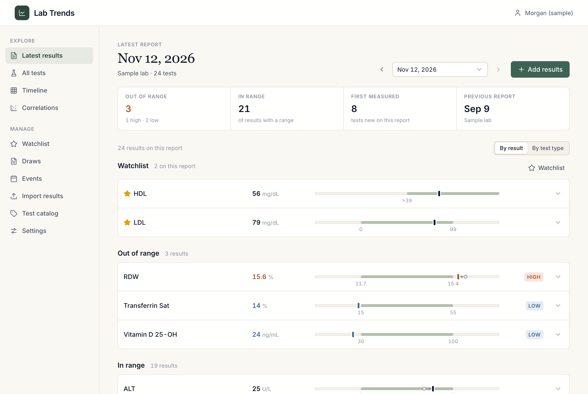
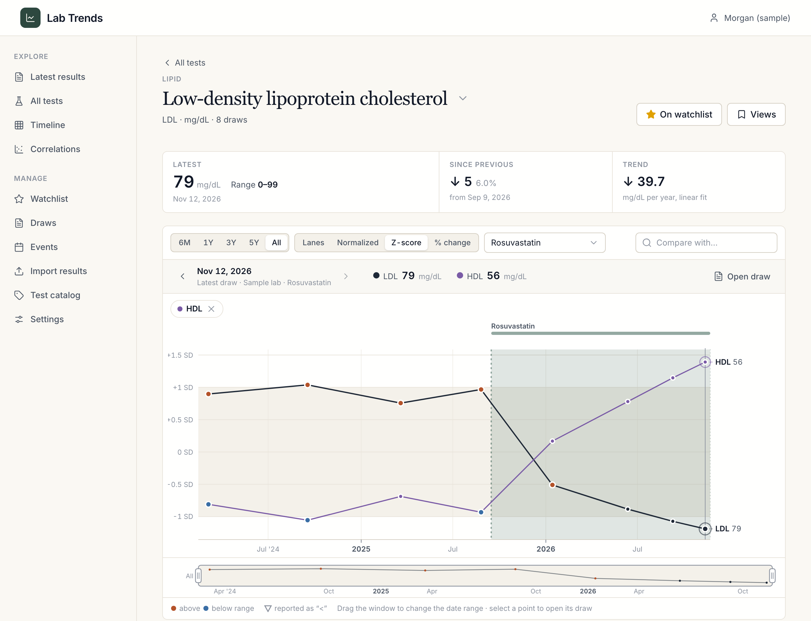

# Lab Trends

Keep all your lab results in one place and see how they change over time. You run your own copy on your own Cloudflare account, so your records stay there and nobody else can reach them, including me.



Upload reports from any lab or patient portal as PDFs, photos or spreadsheets. A model on Cloudflare Workers AI reads the values, you check them against the report, and only then are they saved. From there you can:

- Open each new report and see what's out of range, with the reference range and your previous result next to every value
- Chart any test over its whole history, with medications, illnesses and other events marked on the same timeline
- Overlay tests on one chart, against their reference ranges, as z-scores or as % change
- Look for tests that move together, with the sample size and confidence interval shown so a lead doesn't pass for a finding
- Keep records for more than one person, like a partner or a parent, in the same copy
- Connect Claude or another assistant over MCP to review new results and log events for you ([docs/mcp.md](docs/mcp.md))



Screenshots use the fictional sample data in [`scripts/fixtures/demo.sql`](scripts/fixtures/demo.sql).

Lab Trends keeps and displays what your lab reported. It isn't a medical device and doesn't give medical advice.

## Deploy your own

### What you need

- **A Cloudflare account.** [Sign up](https://dash.cloudflare.com/sign-up) if you don't have one. The free plan covers everything except PDF and photo import.
- **R2 turned on, before you deploy.** In the dashboard go to **Storage & databases > R2 > Overview** and finish the checkout. Cloudflare asks for a payment method even on the free plan, but the first 10 GB are free and this app stays within that. Cloudflare won't create the storage bucket until R2 is on.
- **Workers Paid ($5/month) to import PDFs and photos.** The model that reads them [isn't offered on the free plan](https://developers.cloudflare.com/workers-ai/platform/pricing/). Without it you can still import spreadsheets and type results in.
- **A GitHub or GitLab account** for the deploy button, or **Node.js 22.12+ and git** to deploy from a terminal.

Sign-in is [Cloudflare Access](https://developers.cloudflare.com/cloudflare-one/), which is free. You turn it on during the deploy, so there's nothing to set up ahead of time.

Past the free allowances Cloudflare bills by use: [Workers, D1 and Queues](https://developers.cloudflare.com/workers/platform/pricing/), [R2](https://developers.cloudflare.com/r2/pricing/), [Workers AI](https://developers.cloudflare.com/workers-ai/platform/pricing/).

### Deploy with the button

[](https://deploy.workers.cloudflare.com/?url=https://github.com/alexlmiller/lab-trends)

1. Click the button, sign in to Cloudflare and connect GitHub or GitLab.
2. On the setup form:
   - Tick **Create private Git repository**.
   - Turn on **Protect with Cloudflare Access**. Set the scope to **All traffic** and the policy to **Cloudflare account**, which means the members of your Cloudflare account (just you, unless you've invited others).
   - Keep the suggested names and deploy.
3. Open `https://lab-trends.<your-subdomain>.workers.dev` and sign in. **The first person to sign in becomes the owner**, so do this straight away. On a new account the address can take a few minutes to start working.
4. Add a person, then go to **Import results**. [docs/importing.md](docs/importing.md) covers where to find your files in MyChart, Quest, Labcorp and other portals. The same guide is on that page.

If you left Access off, the app shows a **Turn on sign-in** page and nothing else until you [turn it on](#turn-on-sign-in).

### Deploy from a terminal

```bash
git clone https://github.com/alexlmiller/lab-trends.git
cd lab-trends
npm install
npx wrangler login
npm run deploy
```

`npm run deploy` builds, applies database migrations, then deploys. The first time, Wrangler creates the database, storage bucket and queue, and sets up a `workers.dev` subdomain if the account doesn't have one yet. Then [turn on sign-in](#turn-on-sign-in) and do steps 3 and 4 above.

### Deploy a copy that's already on GitHub

In the Cloudflare dashboard go to **Workers & Pages > Create application > Continue with GitHub** and pick the repository. On the setup form:

- Use `lab-trends` as the project name (the `name` in `wrangler.jsonc`).
- Change the **Deploy command** to `npm run deploy`. The default skips database migrations.
- Turn on Access as in step 2 above.

### If you already use Cloudflare

The same steps work. A few things to know:

- **More than one account:** the deploy page asks which one. With Wrangler, set `CLOUDFLARE_ACCOUNT_ID`.
- **Cloudflare's GitHub app is already installed for another of your accounts:** the button's form may only offer **New GitHub connection** and then have nothing to install. Use [Deploy a copy that's already on GitHub](#deploy-a-copy-thats-already-on-github) instead.
- **Your own domain:** add it under the Worker's **Settings > Domains & Routes**. Access on the Worker covers every address it has. Don't add `routes` to `wrangler.jsonc`, since domains added in the dashboard survive deploys.
- **An Access application already covers the address** (by hostname, or "protect all Workers"): nothing extra to do. The app locks to whichever Access application handles the first sign-in. To pick one explicitly, see [Settings](docs/operating.md#settings).
- **A database, bucket or queue already named `lab-trends`, `lab-trends-files` or `lab-trends-extractions`:** Wrangler reuses it. Rename it on the deploy page or in `wrangler.jsonc` if you don't want that.

### Turn on sign-in

Only needed if you didn't turn on Access during the deploy. Until it's on, the app shows only a setup page and the API refuses every request.

1. In the Cloudflare dashboard, open **Workers & Pages** and select the Worker.
2. Open its **Access** tab and choose **Protect this Worker behind Access**. If it asks you to set up Zero Trust first, pick any team name and the Free plan. It asks for a payment method but doesn't charge for this.
3. Choose **All traffic**. For who can sign in, choose **Cloudflare account**. Then choose **Apply Access**.
4. Reload the app and sign in.

From then on the app only accepts sign-ins through that Access application, and only from the owner and the people the owner adds. If the app shows something other than your results after this, see [Sign-in problems](docs/operating.md#sign-in-problems).

### Let someone else in

You need to add them in two places:

1. **Cloudflare:** allow their email address in the policy on the Worker's Access application (**Zero Trust > Access controls > Policies**).
2. **Lab Trends:** **Settings > People with access > Add someone by email**.

Everyone with access can see and change every person's results. There are no per-person permissions.

## Updating

The deploy button gives you a copy of the code, not a fork, so it won't update on its own. From a checkout of your copy:

```bash
git pull https://github.com/alexlmiller/lab-trends.git main
git push
```

Cloudflare rebuilds and redeploys on push and applies any new migrations first. If you deployed from a terminal, run `git pull && npm install && npm run deploy` instead.

## Privacy

- Everything stays in your Cloudflare account: results in a D1 database, uploaded files in an R2 bucket with no public address.
- Spreadsheets are read inside the app. PDFs have names, dates of birth, record numbers and contact details stripped out before the text goes to the model. Photos go to the model as they are. The default model runs on Workers AI, so none of this leaves Cloudflare.
- The app doesn't load anything from other sites: no fonts, analytics or scripts.
- If you connect an AI assistant, the company that runs it sees whatever it reads.
- Turn on two-factor authentication for your Cloudflare account. Anyone who can sign in to it can read the database.

More detail in [docs/how-it-works.md](docs/how-it-works.md#privacy).

## More docs

| | |
|---|---|
| [Importing](docs/importing.md) | Getting results out of MyChart, Quest, Labcorp, the VA and other portals |
| [Running your copy](docs/operating.md) | Settings, sign-in problems, backups, removing everything |
| [MCP](docs/mcp.md) | Connecting Claude or another AI assistant |
| [How it works](docs/how-it-works.md) | Architecture, sign-in, the import pipeline, privacy details |
| [Contributing](CONTRIBUTING.md) | Running it locally and making changes |

## License

[MIT](LICENSE), with third-party notices in [NOTICE](NOTICE). Please report security problems privately, as described in [SECURITY.md](SECURITY.md).
